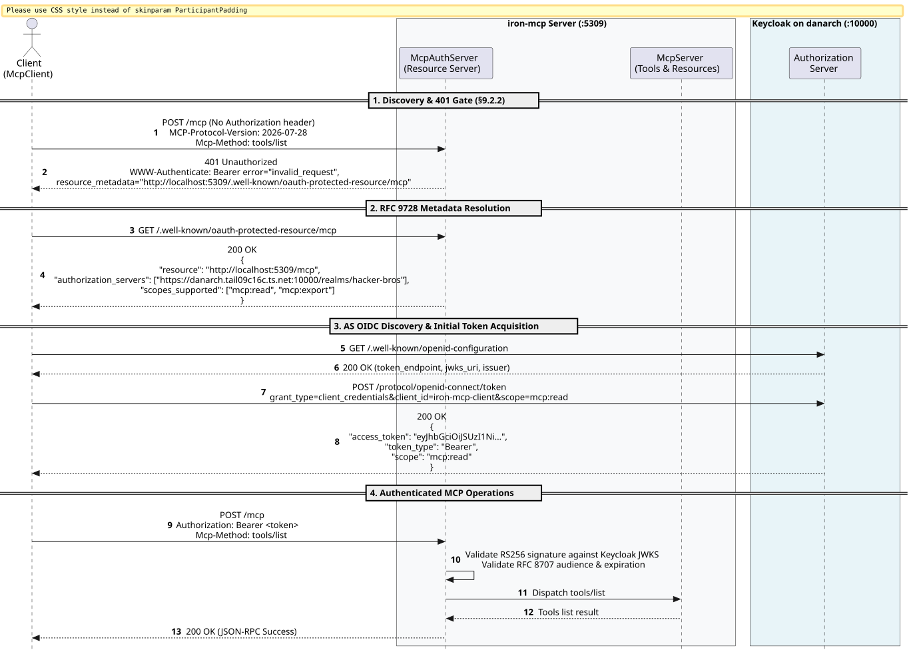
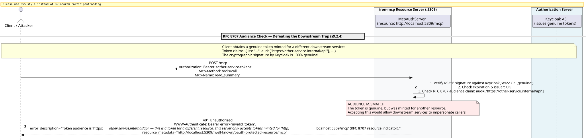
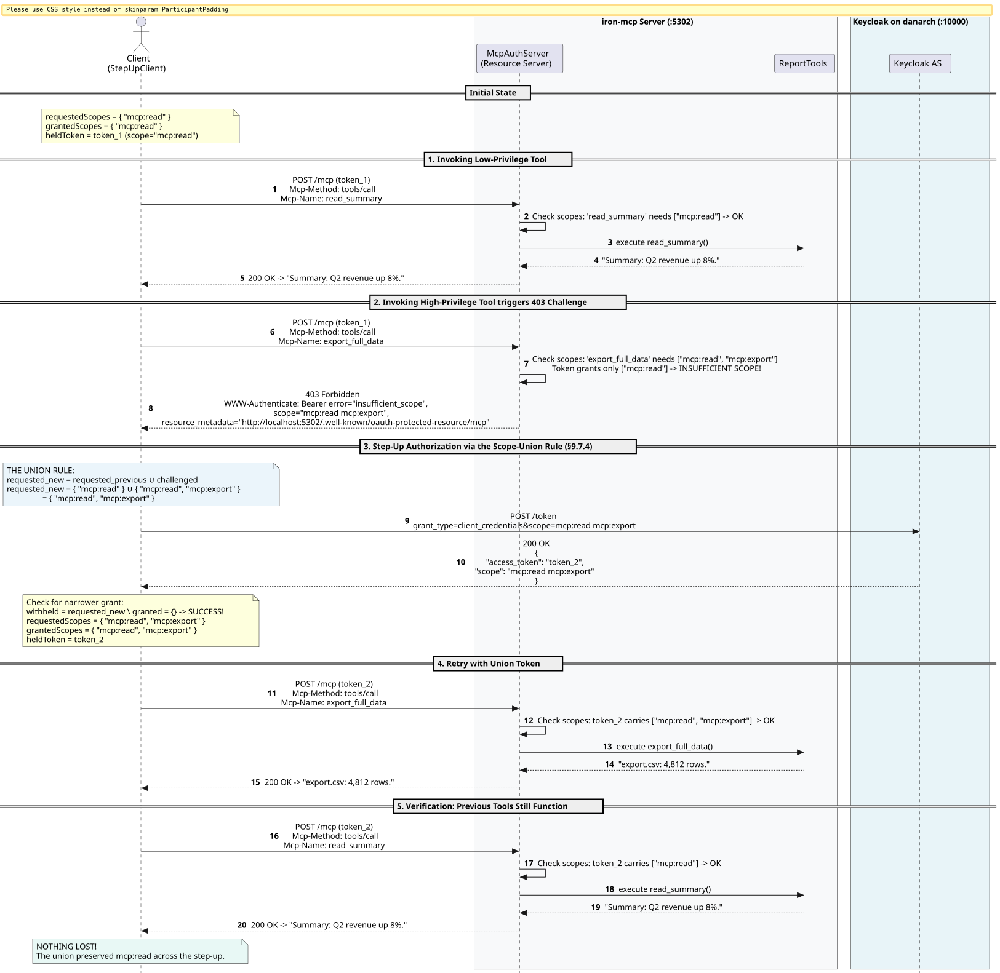
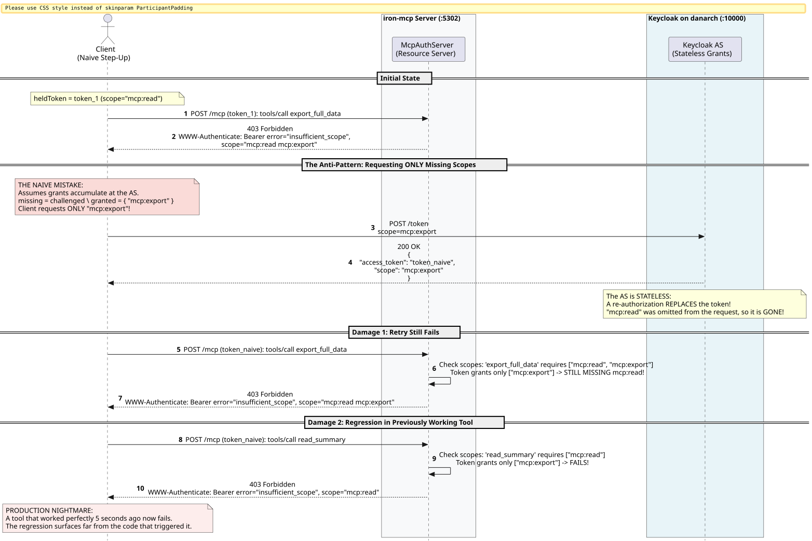

# OAuth 2.1 and Step-Up Authorization in iron-mcp

Comprehensive guide and architectural specification for **OAuth 2.1**, **RFC 9728 Protected Resource Metadata**, **RFC 8707 Audience Binding**, and **SEP-2350 Step-Up Authorization** in `iron-mcp-auth`.

Companion implementation for **The MCP Engineer's Handbook**, Chapter 9:
- **Section 9.2: OAuth 2.1 — The Standard Path**
- **Section 9.2.2: Protected Resource Metadata (RFC 9728)**
- **Section 9.2.4: Audience Binding (RFC 8707) & The Downstream Trap**
- **Section 9.2.7 & 9.7.4: Per-Tool Scope Policies & The 403 Challenge**
- **Section 9.7.4: The Scope-Union Rule and Step-Up Authorization (SEP-2350)**
- **Section 9.2.8: The Token Passthrough Prohibition ("Validate, Don't Forward")**

---

## 1. Architecture Overview

In the MCP Protocol (revision `2026-07-28`), the MCP HTTP Server acts purely as an **OAuth 2.1 Resource Server (RS)**. It does not issue tokens, authenticate user passwords, or display consent screens; those duties belong strictly to a dedicated **Authorization Server (AS)** such as Keycloak, Okta, or Auth0.

```
+-----------------------------------------------------------------------------------------+
|                                    OAUTH 2.1 TOPOLOGY                                   |
|                                                                                         |
|       +------------------------------------+                                            |
|       |     Authorization Server (AS)      |                                            |
|       |  (Keycloak on danarch:10000)       |                                            |
|       |  - Issues RS256 signed JWTs        |                                            |
|       |  - Publishes JWKS at /certs        |                                            |
|       +-----------------+------------------+                                            |
|                         ^                                                               |
|        Token Request /  | Discover & Validate                                           |
|        Step-Up Union    | RS256 JWKS Keys                                               |
|                         |                                                               |
|   +---------------------+------+               +------------------------------------+   |
|   |        MCP Client          |   HTTP POST   |       iron-mcp Server (:5302)      |   |
|   |  - McpHttpClient           | ------------> | - McpAuthServer (Resource Server)  |   |
|   |  - StepUpClient            | <------------ | - TokenValidator (RS256 / HS256)   |   |
|   |  - Scope-Union Rule        | 401/403/200   | - ToolScopePolicy (Per-Tool Scopes)|   |
|   |  - Remembers requested     |               | - McpServer (Dispatches tools)     |   |
|   +----------------------------+               +------------------------------------+   |
+-----------------------------------------------------------------------------------------+
```

### The Rejection Ladder

Every incoming MCP request traverses an explicit rejection ladder. Each rung enforces one security guarantee:

| Request Condition | HTTP Status | Response Header & Body | Architectural Obligation |
| :--- | :--- | :--- | :--- |
| **No / Missing Token** | `401 Unauthorized` | `WWW-Authenticate: Bearer error="invalid_request", resource_metadata="..."` | **RFC 9728 Discovery (§9.2.2)**: Points the client to the Resource Server's metadata document. |
| **Genuine Token, Wrong Audience** | `401 Unauthorized` | `WWW-Authenticate: Bearer error="invalid_token", error_description="...different resource... (RFC 8707)", resource_metadata="..."` | **RFC 8707 Audience Binding (§9.2.4)**: Thwarts the Downstream Trap. A token must name *this* server in its `aud` claim. |
| **Right Audience, Missing Tool Scope** | `403 Forbidden` | `WWW-Authenticate: Bearer error="insufficient_scope", scope="<full required>", resource_metadata="..."` | **Per-Tool Scope Policy (§9.2.7 & §9.7.4)**: Drives Step-Up. Challenge names the full scope set needed for the tool. |
| **Right Audience, Sufficient Scopes** | `200 OK` | JSON-RPC tool result or SSE message event | **Authorized Tool Execution**: Closes tools over caller claims. |

---

## 2. Discovery & The 401 Gate (RFC 9728)

When an unauthenticated client sends a request to the MCP endpoint (e.g. `POST /mcp`), the server rejects it with `401 Unauthorized`. Crucially, the response header carries the `resource_metadata` parameter:

```http
HTTP/1.1 401 Unauthorized
WWW-Authenticate: Bearer error="invalid_request", resource_metadata="http://localhost:5309/.well-known/oauth-protected-resource/mcp"
```

The client follows this pointer to obtain the **RFC 9728 Protected Resource Metadata document**:

```bash
curl -s http://localhost:5309/.well-known/oauth-protected-resource/mcp
```

```json
{
  "resource": "http://localhost:5309/mcp",
  "authorization_servers": [
    "https://danarch.tail09c16c.ts.net:10000/realms/hacker-bros"
  ],
  "scopes_supported": [
    "mcp:read",
    "mcp:export"
  ],
  "bearer_methods_supported": [
    "header"
  ]
}
```

From this document, the client learns:
1. The canonical **resource indicator** (`resource`: `http://localhost:5309/mcp`), which it must specify when requesting tokens (RFC 8707).
2. The authoritative **Authorization Server** (`authorization_servers`), directing the client to Keycloak's OIDC discovery endpoint (`/.well-known/openid-configuration`).

### Sequence Diagram: Discovery & 401 Gate



---

## 3. RFC 8707 Audience Binding & The Downstream Trap

### Why Signature Verification is Not Enough

A common security vulnerability in OAuth resource servers is verifying only the token's cryptographic signature and expiration.

> [!CAUTION]
> **The Downstream Trap (§9.2.4)**
> Suppose an authorized client interacts with Service A and Service B, both protected by the same corporate Keycloak realm.
> If Service B is compromised, it could replay the user's genuine Bearer token against Service A!
> If Service A only checks `verifySignature(token)`, the token passes because Keycloak legitimately signed it.
> Service B successfully impersonates the user against Service A.

**The Solution: RFC 8707 Resource Indicators.**
When a client requests a token, it specifies `resource=http://localhost:5309/mcp`. Keycloak includes this canonical URI in the token's `aud` (audience) claim.

When `iron-mcp-auth` validates an incoming token:
```scala
if (!claims.aud.contains(expectedResource)) {
  Left(AuthError.WrongAudience(expectedResource, claims.aud))
}
```

If the token belongs to another resource, `iron-mcp` rejects it immediately with HTTP 401:

```json
{
  "error": "invalid_token",
  "error_description": "Token audience is 'https://other-service.internal/api' — this is a token for a different resource. This server only accepts tokens minted for 'http://localhost:5309/mcp' (RFC 8707 resource indicator)."
}
```

### Sequence Diagram: Defeating the Downstream Trap



---

## 4. Per-Tool Scope Policies & The 403 Challenge

Different tools require different levels of authorization. For example:
- `read_summary`: read-only access (requires `mcp:read`).
- `export_full_data`: sensitive bulk export (requires `mcp:read` AND `mcp:export`).

### 403 Forbidden vs 401 Unauthorized

> [!NOTE]
> A scope failure is HTTP **403 Forbidden**, never `401 Unauthorized`.
> The token *is* authentic and valid for this resource server; the operation just exceeds what was granted.

### The Challenge Names the FULL Required Set

When `export_full_data` is invoked with a token holding only `mcp:read`, the server responds:

```http
HTTP/1.1 403 Forbidden
WWW-Authenticate: Bearer error="insufficient_scope", scope="mcp:read mcp:export", resource_metadata="http://localhost:5302/.well-known/oauth-protected-resource/mcp"

{
  "error": "insufficient_scope",
  "error_description": "'export_full_data' requires [mcp:read mcp:export]; the token grants [mcp:read]."
}
```

Notice that the `scope` parameter names **everything** the tool needs (`mcp:read mcp:export`), not just the missing slice (`mcp:export`). The server stays stateless about past interactions and describes complete operational requirements in one single challenge.

---

## 5. The Scope-Union Rule & Step-Up (SEP-2350)

Step-up authorization (SEP-2350, Handbook §9.7.4) specifies how clients handle `403 insufficient_scope` challenges.

### The Scope-Union Rule

$$\text{requestedScopes}_{\text{new}} = \text{requestedScopes}_{\text{previous}} \cup \text{challengeScopes}$$

When the 403 challenge arrives:
1. The client parses the challenged scopes (`challengeScopes`).
2. The client computes the **union** with all scopes it has previously requested (`requestedScopes`).
3. The client requests a new token for the union from the Authorization Server.
4. The client retries the tool call.

### Sequence Diagram: Step-Up with the Scope-Union Rule



---

### The `--naive` Anti-Pattern (Why Scope Accumulation is the Client's Job)

Why can't the client simply request only the missing scope (`mcp:export`)?

> [!WARNING]
> **The Naive Regression (§9.7.4)**
> Authorization Servers and Resource Servers are stateless about past grants.
> In OAuth 2.1, obtaining a new access token **replaces** the previous token.
> If the client asks only for the missing scope (`mcp:export`), Keycloak returns a token granting *only* `mcp:export`.
>
> Two catastrophic failures occur:
> 1. **The retry fails**: `export_full_data` requires `mcp:read` too, which is no longer in the token.
> 2. **Silent regression in previously working tools**: Calling `read_summary` (which worked 5 seconds ago) now crashes with a 403 challenge!

### Sequence Diagram: The Naive Regression



---

### Narrower Grants

What if the user or policy declines consent for a sensitive scope?
If the client requested `mcp:read mcp:export` but Keycloak granted only `mcp:read`:

```scala
val withheld = requestedScopes -- grantedScopes
if (withheld.nonEmpty) {
  // Halt immediately. Retrying will only produce another 403.
  throw NarrowerGrantException(operation, withheld, grantedScopes)
}
```

`StepUpClient` detects narrower grants and halts with an informative diagnostic instead of entering an infinite retry loop.

---

## 6. Type-Checked Implementation Walkthrough

All code examples below are verified by `mdoc` against `iron-mcp-core`, `iron-mcp-http`, and `iron-mcp-auth`.

### Defining Per-Tool Scope Policies

```scala mdoc:silent
import ironmcp.auth.ToolScopePolicy

val policy = ToolScopePolicy.Builder.empty
  .require("read_summary", "mcp:read")
  .require("export_full_data", "mcp:read", "mcp:export")
  .require("admin_purge", "mcp:admin")
  .build
```

Checking tool requirements against granted scopes:

```scala mdoc
// Caller with only read permission
policy.check("read_summary", Set("mcp:read"))

// Insufficient scope: returns the full required set
policy.check("export_full_data", Set("mcp:read"))

// Sufficient scopes
policy.check("export_full_data", Set("mcp:read", "mcp:export"))
```

---

### Setting up the Resource Server (`McpAuthServer`)

```scala mdoc:silent
import cats.effect.IO
import io.github.iltotore.iron.*
import io.github.iltotore.iron.autoRefine
import ironmcp.auth.*
import ironmcp.http.McpHttp
import ironmcp.protocol.Implementation
import ironmcp.server.*
import io.circe.Decoder
import ironmcp.schema.JsonSchemaOf

final case class ReportQuery(format: Option[String] = None) derives Decoder, JsonSchemaOf

val tool = McpTool[ReportQuery]("read_summary", "Read summary")(_ => IO.pure("Summary data"))
val mcpServer = McpServer[IO](
  info = Implementation(name = "reports", version = "1.0.0"),
  tools = Some(ToolSet.of(tool))
)

val metadata = ProtectedResourceMetadata(
  resource = "http://localhost:5302/mcp",
  authorization_servers = List("https://danarch.tail09c16c.ts.net:10000/realms/hacker-bros"),
  scopes_supported = Some(List("mcp:read", "mcp:export"))
)

val authConfig = McpAuthServer.Config(
  mcpConfig = McpHttp.Config(path = "/mcp"),
  serverUrl = "http://localhost:5302",
  metadata = metadata,
  scopePolicy = policy
)
```

---

### Configuring the Token Validator (RS256 & Keycloak JWKS)

`iron-mcp-auth` verifies RS256 signatures with zero reflection, pure Scala, and standard `java.security.KeyFactory`:

```scala mdoc:silent
import org.http4s.Uri
import org.http4s.client.Client

def createValidator(httpClient: Client[IO], jwksUri: Uri): IO[TokenValidator[IO]] =
  for
    jwksProvider <- JwksProvider.keycloak[IO](httpClient, jwksUri)
    validator = TokenValidator.rs256[IO](
      jwksProvider,
      TokenValidator.Config(
        expectedResource = Some("http://localhost:5302/mcp"),
        expectedIssuer = Some("https://danarch.tail09c16c.ts.net:10000/realms/hacker-bros")
      )
    )
  yield validator
```

---

### Hiding Tools the Token Cannot Call

The C# SDK filters `tools/list` by `[Authorize]`. Here, `ScopedTools` does the same thing. Build it per request from the validated claims, inside `routesFor`:

```scala mdoc:silent
def scopedRoutes(validator: TokenValidator[IO]) =
  McpAuthServer.routesFor(validator, authConfig) { (_, claims) =>
    IO.pure(Right(McpServer[IO](
      info = Implementation(name = "reports", version = "1.0.0"),
      tools = Some(ScopedTools(ToolSet.of(tool), authConfig.scopePolicy, claims))
    )))
  }
```

A token with only `mcp:read` sees only the tools that `mcp:read` allows. Because the list depends on the token, it is sent with `cacheScope: "private"`.

Hiding a tool keeps it away from the model, but it does not protect the tool. A client can still call a tool it never saw listed. That call gets the same `403 insufficient_scope` challenge as before, so the scope policy at execution time is still what protects the tool.

---

### Using `StepUpClient` for Automatic Scope-Union Retries

```scala mdoc:silent
// Given a function that acquires tokens from Keycloak for any requested scope set
def acquireTokenFromKeycloak(requestedScopes: Set[String]): IO[TokenResponse] =
  IO.pure(TokenResponse("jwt_token_here", "Bearer", Some(3600), None, Some(requestedScopes.mkString(" "))))

val stepUpInit = for
  client <- StepUpClient.create[IO](acquireTokenFromKeycloak, strategy = ScopeStrategy.Union)
  // Request minimal initial scope
  _ <- client.initialAuthorize(Set("mcp:read"))
  headers <- client.authHeaders
yield headers
```

---

### The Client Flow: Discovery, PKCE and Refresh (`OAuthClient`)

`OAuthClient` is the client side of MCP authorization, going from the first `401` to a token:

1. **Discovery.** `discover(rejection, resource)` reads `resource_metadata` from the challenge and fetches the RFC 9728 document. It checks that the document names the resource that was called. It then fetches the authorization server's RFC 8414 metadata (or its OpenID configuration) and checks the `issuer`.
2. **Trust.** Only an authorization server on the client's allowlist is ever contacted. The resource server is the one that names it, and a client that follows any name can be sent to an attacker (the class of bug in GHSA-6qxp-vccf-f47h).
3. **Authorization code with PKCE S256.** A server that does not advertise `S256` is refused before the user is sent anywhere. Every request carries the RFC 8707 `resource` parameter, and the redirect's `state` must match.
4. **Refresh.** `authorizer` refreshes when the requested scopes are already granted. A refresh cannot widen a grant, so a step-up goes back to the user.

`authorizer` has exactly the shape `StepUpClient.create` takes, so the Scope-Union Rule and the refresh-on-401 come together:

```scala mdoc:silent
import cats.effect.std.SecureRandom

def connect(http: Client[IO], rejection: ironmcp.client.McpClientError.Http, openBrowser: Uri => IO[AuthorizationResponse]) =
  for
    random    <- SecureRandom.javaSecuritySecureRandom[IO]
    oauth      = OAuthClient[IO](http, random, trusted = Set("https://danarch.tail09c16c.ts.net:10000/realms/hacker-bros"))
    found     <- oauth.discover(rejection, resource = "http://localhost:5302/mcp")
    authorize <- oauth.authorizer(found, clientId = "mcp-client", redirectUri = "http://127.0.0.1:7777/callback", openBrowser)
    stepUp    <- StepUpClient.create[IO](authorize)
  yield stepUp
```

`openBrowser` opens the URL and returns the `code` and `state` from the redirect. Typically it runs a loopback listener on `redirectUri`.

---

## 7. Verification and Testing Checklist

When deploying or testing an OAuth 2.1 protected MCP server:

1. **Verify RFC 9728 Discovery**:
   - `curl -si http://localhost:5302/mcp -X POST -H 'MCP-Protocol-Version: 2026-07-28' -H 'Mcp-Method: tools/list'`
   - Confirm status is `401 Unauthorized` and `WWW-Authenticate` header contains `resource_metadata`.
   - `curl -s http://localhost:5302/.well-known/oauth-protected-resource/mcp`
   - Confirm returned JSON matches `ProtectedResourceMetadata`.
2. **Verify RFC 8707 Audience Check**:
   - Mint a token whose `aud` is set to `https://other.service/mcp`.
   - Call `/mcp` with `Authorization: Bearer $TOKEN`.
   - Confirm response is `401 Unauthorized` naming `invalid_token` and explaining audience mismatch.
3. **Verify Per-Tool 403 Challenge**:
   - Call `read_summary` with `mcp:read` token: verify `200 OK`.
   - Call `export_full_data` with `mcp:read` token: verify `403 Forbidden` with `error="insufficient_scope"` and `scope="mcp:read mcp:export"`.
4. **Verify The Scope-Union Rule**:
   - Re-authorize for `mcp:read mcp:export`.
   - Retry `export_full_data`: verify `200 OK`.
   - Re-call `read_summary`: verify `200 OK` (proving `mcp:read` was not lost).
