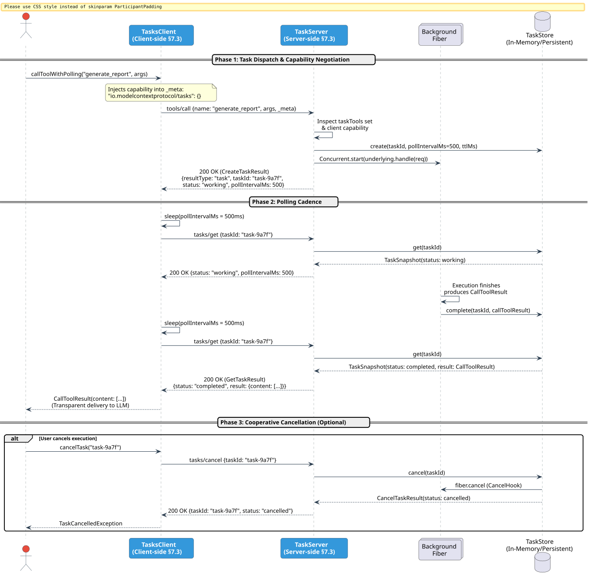

# Tasks Extension & Async Polling (`io.modelcontextprotocol/tasks`)

The **Tasks Extension** (standardized in SEP-2663 and detailed in Section 7.3 of the *MCP Engineering Handbook*) defines an asynchronous execution model for tools that exceed standard request-response timeouts or require prolonged background processing.

In traditional stateless MCP (revision 2026-07-28), tool invocations are synchronous: the client sends `tools/call` and blocks until the server delivers `CallToolResult`. For compute-intensive workloads (e.g., simulations, multi-step LLM batch runs, database exports), this can cause HTTP socket timeouts, buffer exhaustion, or broken connections.

The `iron-mcp-tasks` module provides an end-to-end, reflection-free, cross-compiled (JVM + Scala Native) implementation of the Tasks Extension.

---

## 1. Architectural Lifecycle

The tasks protocol operates on a server-directed asynchronous model:

1. **Capability Declaration**: Clients declare support for the extension by including `"io.modelcontextprotocol/tasks": {}` in `_meta.io.modelcontextprotocol/clientCapabilities.extensions`.
2. **Server-Directed Task Creation**: If the requested tool is marked as asynchronous and the client declared task capability, the server immediately returns a `CreateTaskResult` (`resultType: "task"`) containing a unique `taskId` and a suggested `pollIntervalMs`.
3. **Non-Blocking Polling**: The client polls task status using `tasks/get`. The server answers with a `GetTaskResult` containing current status (`working`, `input_required`, `completed`, `failed`, or `cancelled`).
4. **Inlined Final Result**: When the status reaches `completed`, the snapshot inlines the final `CallToolResult`. There is no separate `tasks/result` endpoint.
5. **Cooperative Cancellation**: Clients can abort unneeded runs via `tasks/cancel`, terminating the background fiber on the server.

### Lifecycle Sequence Diagram



---

## 2. Server Implementation (`TaskServer` & `TaskStore`)

A server designates which tools run asynchronously by wrapping any `ServerHandler[F]` with `TaskServer`.

```scala mdoc
import cats.effect.IO
import cats.effect.std.SecureRandom
import cats.effect.unsafe.implicits.global
import io.circe.*
import io.circe.syntax.*
import io.github.iltotore.iron.*
import io.github.iltotore.iron.autoRefine
import io.github.iltotore.iron.constraint.all.*
import ironmcp.client.ClientTransport
import ironmcp.protocol.*
import ironmcp.schema.JsonSchemaOf
import ironmcp.server.*
import ironmcp.tasks.*
import ironmcp.tasks.TaskModels.*
import scala.concurrent.duration.*

// Define an input argument schema for a long-running simulation
final case class SimulationArgs(experimentId: String, steps: Int) derives Decoder, JsonSchemaOf

// Define the tool program
val simulationTool = McpTool[SimulationArgs]("run_simulation", "Runs Monte Carlo simulation") { args =>
  IO.sleep(30.millis).as(s"Simulation '${args.experimentId}' finished after ${args.steps} steps.")
}

val fastEchoTool = McpTool[SimulationArgs]("quick_ping", "Instant response") { args =>
  IO.pure(s"Pong: ${args.experimentId}")
}
```

### Wrapping the Base Server

The server advertises `io.modelcontextprotocol/tasks` in `server/discover` capabilities and manages background fibers:

```scala mdoc
val serverIO: IO[TaskServer[IO]] = for {
  random <- SecureRandom.javaSecuritySecureRandom[IO]
  store <- TaskStore.inMemory[IO](defaultPollIntervalMs = 50L)
  baseServer = McpServer[IO](
    info = Implementation(name = "simulation-engine", version = "1.0.0"),
    tools = Some(ToolSet.of(simulationTool, fastEchoTool))
  )
  taskServer = TaskServer[IO](
    underlying = baseServer,
    store = store,
    random = random,
    taskTools = Set("run_simulation"), // only simulation runs as background task
    defaultPollIntervalMs = 50L
  )
} yield taskServer

val taskServer = serverIO.unsafeRunSync()
```

---

## 3. Client Implementation (`TasksClient`)

The client side offers two operating modes:
1. **The Transparent Path (`callToolWithPolling`)**: Hides the polling loop behind a single synchronous-looking call. If the server offloads the tool to a task, `TasksClient` polls automatically until completion.
2. **Explicit Task Operations**: Direct control over `callToolAsTask`, `getTask`, `cancelTask`, and `updateTask`.

### The Transparent Path

```scala mdoc
val transparentRun: IO[CallToolResult] = for {
  client <- TasksClient[IO](ClientTransport.inProcess[IO](taskServer))
  res <- client.callToolWithPolling(
    "run_simulation",
    JsonObject("experimentId" -> "MC-101".asJson, "steps" -> 50000.asJson),
    defaultPollInterval = 20.millis
  )
} yield res

val simulationResult = transparentRun.unsafeRunSync()
println(simulationResult.content.headOption)
```

For fast, synchronous tools like `quick_ping`, `callToolWithPolling` returns immediately without polling overhead:

```scala mdoc
val fastRun: IO[CallToolResult] = for {
  client <- TasksClient[IO](ClientTransport.inProcess[IO](taskServer))
  res <- client.callToolWithPolling(
    "quick_ping",
    JsonObject("experimentId" -> "ping-test".asJson, "steps" -> 1.asJson)
  )
} yield res

val fastResult = fastRun.unsafeRunSync()
println(fastResult.content.headOption)
```

---

## 4. Explicit Lifecycle & Cooperative Cancellation

When building custom UI or monitoring dashboards, clients can dispatch tasks explicitly and poll or cancel them:

```scala mdoc
val cancelRun: IO[(CancelTaskResult, GetTaskResult)] = for {
  client <- TasksClient[IO](ClientTransport.inProcess[IO](taskServer))
  dispatch <- client.callToolAsTask(
    "run_simulation",
    JsonObject("experimentId" -> "long-run".asJson, "steps" -> 999999.asJson)
  )
  created = dispatch match {
    case c: CreateTaskResult => c
    case _                   => sys.error("expected task")
  }
  // Request cooperative cancellation
  cancelRes <- client.cancelTask(created.taskId)
  snap <- client.getTask(created.taskId)
} yield (cancelRes, snap)

val (cancelRes, finalSnapshot) = cancelRun.unsafeRunSync()
println(s"Cancelled task: ${cancelRes.taskId}, status: ${finalSnapshot.status}")
```

---

## 5. Asking the Caller Mid-Flight (`TaskTool`)

A plain tool that needs input answers `tools/call` with `input_required` and runs again from the start when the client retries with the answers. A tool running as a task can do better: it asks through its `TaskContext`, the task goes `input_required` with the requests in its `tasks/get` snapshot (`inputRequests`), and the client's `tasks/update` with `inputResponses` resumes it where it stopped, with the work it had done kept.

```scala mdoc
final case class Order(item: String) derives Decoder, JsonSchemaOf
final case class Confirm(confirm: Boolean) derives Decoder, JsonSchemaOf

val checkout = TaskTool[IO, Order]("checkout", "Reserves an item, asks, then buys it.") { (order, task) =>
  for {
    _      <- task.status(s"reserved ${order.item}")
    answer <- task.ask(Map("confirm" -> Elicit.form[Confirm](s"Buy ${order.item}?")))
    yes     = answer.get("confirm").flatMap(_.hcursor.downField("content").get[Boolean]("confirm").toOption).contains(true)
  } yield if (yes) s"bought ${order.item}" else s"released ${order.item}"
}

val shop: IO[TaskServer[IO]] = for {
  random <- SecureRandom.javaSecuritySecureRandom[IO]
  store  <- TaskStore.inMemory[IO](defaultPollIntervalMs = 10L)
  base    = McpServer[IO](Implementation("shop", "1.0.0"), tools = Some(ToolSet.of(checkout.mcpTool)))
} yield TaskServer[IO](base, store, random, inputTools = List(checkout))
```

`checkout.mcpTool` is how the tool is listed, and how it runs for a client that does not declare the extension: there, asking is a tool error, since a request has no way to wait. `TasksClient` answers `input_required` with its `InputHandlers`, as `McpClient.callToolGathering` does for a tool result:

```scala mdoc
import ironmcp.client.InputHandlers

val bought: CallToolResult = (for {
  server <- shop
  client <- TasksClient[IO](
              ClientTransport.inProcess[IO](server),
              handlers = InputHandlers.elicitation[IO](_ =>
                IO.pure(ElicitResult(ElicitAction.Accept, Some(JsonObject("confirm" -> true.asJson))))
              )
            )
  res <- client.callToolWithPolling("checkout", JsonObject("item" -> "lamp".asJson), defaultPollInterval = 10.millis)
} yield res).unsafeRunSync()

println(bought.content.headOption)
```

---

## 6. Durable Tasks (`TaskStore.journaled`)

`TaskStore.inMemory` loses every task when the process stops. `TaskStore.journaled` keeps them, in the manner of the LMAX architecture: the state lives in memory, every change is an event, and the events go to disk before anyone is answered.

- **One writer.** A single fiber takes changes in order, decides each against the state in memory, and writes the batch's events with one write and one sync. Only then is the new state visible and the callers answered. Reads come from memory.
- **Events and snapshots.** `FileTaskJournal` appends events to JSON-lines segments, and snapshots the whole state every `snapshotEvery` events and on a clean shutdown. Opening loads the latest snapshot and replays the events after it. A last line cut short by a crash is dropped, because its batch was never answered. Damage anywhere else fails the open rather than losing tasks quietly. The files are owner-only, since they hold tool arguments and results.
- **Fail-stop.** If the journal cannot write, the store takes no more changes (`TaskJournalFailed`), so memory and disk never part ways.

A process can't write down its fibers, so a restart leaves running tasks with nothing running them. `TaskServer.recover` deals with each one:

- A **resumable** `TaskTool` runs again with the call that started it. Each step it finished through `task.step` returns its recorded result instead of running again, so the run picks up after its last finished step.
- An answer that arrived while it was down is taken as soon as the task asks the same question again.
- Any other task fails, with the message "the server restarted while this task ran".

Retention is required. `TaskStore.journaled` takes a `defaultTtlMs` with no default of its own, and `task.retain(ttl)` sets how long one task is kept once it finishes, as its `ttlMs`. There is no keeping a task forever.

```scala mdoc
import cats.effect.Resource
import java.nio.file.Files

val reserve = TaskTool[IO, Order]("reserve", "Reserves an item, asks, then buys it.", resumable = true) { (order, task) =>
  for {
    _      <- task.retain(7.days)
    held   <- task.step("reserve")(IO.pure(s"reserved ${order.item}"))
    answer <- task.ask(Map("confirm" -> Elicit.form[Confirm](s"Buy ${order.item}?")))
    yes     = answer.get("confirm").flatMap(_.hcursor.downField("content").get[Boolean]("confirm").toOption).contains(true)
    done   <- task.step("buy")(IO.pure(if (yes) s"bought ${order.item}" else s"released ${order.item}"))
  } yield s"$held, $done"
}

def durableShop(dir: java.nio.file.Path): Resource[IO, TaskServer[IO]] = for {
  store  <- FileTaskJournal.open[IO](dir).flatMap(TaskStore.journaled[IO](_, defaultTtlMs = 30.days.toMillis))
  random <- Resource.eval(SecureRandom.javaSecuritySecureRandom[IO])
  base    = McpServer[IO](Implementation("shop", "1.0.0"), tools = Some(ToolSet.of(reserve.mcpTool)))
  server  = TaskServer[IO](base, store, random, defaultPollIntervalMs = 10L, inputTools = List(reserve))
  _      <- Resource.eval(server.recover)
} yield server

val journalDir = Files.createTempDirectory("shop-tasks")

// The first process starts a task, which stops to ask; then the process stops.
val taskId: String = durableShop(journalDir).use { server =>
  for {
    client  <- TasksClient[IO](ClientTransport.inProcess[IO](server))
    created <- client.callToolAsTask("reserve", JsonObject("item" -> "lamp".asJson))
    id       = created match { case c: CreateTaskResult => c.taskId; case other => sys.error(s"$other") }
    _       <- client.getTask(id).iterateUntil(_.status == TaskStatus.InputRequired)
  } yield id
}.unsafeRunSync()

// The next process recovers it: still asking, and the answer finishes it.
val resumed: GetTaskResult = durableShop(journalDir).use { server =>
  for {
    client <- TasksClient[IO](ClientTransport.inProcess[IO](server))
    _      <- client.getTask(taskId).iterateUntil(_.status == TaskStatus.InputRequired)
    _      <- client.updateTask(taskId, Map("confirm" -> ElicitResult(ElicitAction.Accept, Some(JsonObject("confirm" -> true.asJson))).asJson))
    done   <- client.getTask(taskId).iterateUntil(_.status.isTerminal)
  } yield done
}.unsafeRunSync()

println(resumed.result.flatMap(_.content.headOption))
```

`FileTaskJournal` is JVM-only for now. The store, its events and `recover` are cross-built, so a Native server can use a journal of its own.

The store is built on `iron-mcp-eventlog`, which has nothing MCP in it: `EventLog.journaled` is the single writer, and `FileEventJournal` the files, for any event type `E` and state `S` with an `Evolve[S, E]` and circe codecs. `TaskJournal[F]` is `EventJournal[F, TaskEvent, TaskState]`, and `FileTaskJournal.open` is `FileEventJournal.open` at those types, so a library that keeps state of its own can journal it the same way.

---

## 7. Protocol Wire Messages Reference

### `tools/call` Response (Task Created)
```json
{
  "jsonrpc": "2.0",
  "id": 1,
  "result": {
    "resultType": "task",
    "taskId": "task-18e38d0a",
    "status": "working",
    "pollIntervalMs": 500,
    "ttlMs": 300000
  }
}
```

### `tasks/get` Response (Completed)
```json
{
  "jsonrpc": "2.0",
  "id": 2,
  "result": {
    "taskId": "task-18e38d0a",
    "status": "completed",
    "createdAt": 1730847000,
    "lastUpdatedAt": 1730847002,
    "ttlMs": 300000,
    "result": {
      "content": [
        {
          "type": "text",
          "text": "Simulation finished after 50000 steps."
        }
      ],
      "isError": false
    }
  }
}
```

### `tasks/get` Response (Input Required)
```json
{
  "jsonrpc": "2.0",
  "id": 3,
  "result": {
    "taskId": "task-5b0c2f9e",
    "status": "input_required",
    "statusMessage": "reserved lamp",
    "inputRequests": {
      "confirm": {
        "method": "elicitation/create",
        "params": { "mode": "form", "message": "Buy lamp?", "requestedSchema": { "type": "object", "properties": { "confirm": { "type": "boolean" } }, "required": ["confirm"] } }
      }
    }
  }
}
```

### `tasks/update` Request
```json
{
  "jsonrpc": "2.0",
  "id": 4,
  "method": "tasks/update",
  "params": {
    "taskId": "task-5b0c2f9e",
    "inputResponses": { "confirm": { "action": "accept", "content": { "confirm": true } } }
  }
}
```

### `tasks/cancel` Response
```json
{
  "jsonrpc": "2.0",
  "id": 3,
  "result": {
    "taskId": "task-18e38d0a",
    "status": "cancelled"
  }
}
```
