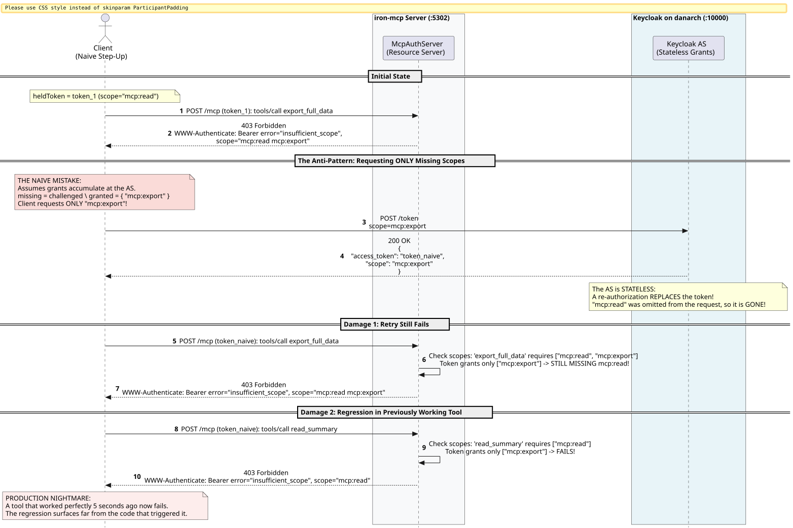

# Authorization in iron-mcp

`iron-mcp-auth` makes an MCP server an OAuth 2.1 **resource server**, and an MCP client a careful OAuth client. It follows the MCP authorization spec (revision `2026-07-28`), RFC 9728, RFC 8707, RFC 9068, RFC 6750, SEP-2350 (step-up) and RFC 7662 (introspection).

**The easy path is the strict one.** A validator needs an issuer and an audience before it compiles. A tool that does not say who may call it can be called by nobody. A token without `exp` is refused. You have to write code to weaken any of this; you never have to write code to get it.

---

## 1. What it stops

| Attack | What stops it |
| :--- | :--- |
| A genuine token minted for another service is replayed here (the downstream trap) | `aud` must equal this server's resource URI (RFC 8707); `TokenValidator.Config` has no default for it |
| A token from another realm or IdP | `iss` must equal the configured issuer |
| An OIDC ID token, or a refresh token, presented as an access token | the token-type profile: `typ: at+jwt` (RFC 9068), or Keycloak's payload `typ: Bearer` |
| `alg: none`; HS256 "signed" with the server's RSA public key (algorithm confusion) | the algorithm allowlist comes from config, never from the token; each key is tied to its type, curve and declared `alg` |
| ECDSA signatures with `r = 0` or `s = 0` (CVE-2022-21449) | refused before the JDK sees them |
| Weak keys; encryption keys in the JWKS | RSA under 2048 bits, `use: enc`, `key_ops` without `verify`, private JWKs, and EC points off their curve are dropped |
| A token with no `kid` checked against "the first key" | without `kid`, a token matches only if exactly one key fits |
| Random `kid`s used to flood the authorization server | one JWKS fetch at a time, and an unknown `kid` refetches at most every 30 s |
| A token that never expires, or not yet valid, or issued in the future | `exp` required; `nbf` and `iat` checked; optional `maxAge` |
| Oversized tokens | refused over 8 KiB before any decoding |
| A forgotten scope rule | `AuthPolicy` denies anything it does not name; `undeclared` lists such tools at startup |
| Calling a tool the caller cannot see | refused at the HTTP layer (`403`) and again inside `ScopedTools` |
| Reading resources or prompts without scope | gated by URI prefix and by name, as tools are |
| Reading or cancelling someone else's task by ID | tasks carry an owner (`TaskServer(owner = ...)`) |
| A header naming one tool while the body calls another | McpHttp checks `Mcp-Name` against the body before auth runs |
| Quote or CRLF injection into `WWW-Authenticate` | every parameter is an escaped quoted-string; descriptions are fixed text, never token contents |
| An invalid token on a public tool treated as anonymous | an invalid token is always `401`, even in optional sign-in |
| A stolen token used after the user signs out | `RevocationList` (`jti`, `sid`, subject) and RFC 7662 introspection, layered on local checks |
| The JWKS endpoint is down | `503`, never a pass |
| "Who did that?" | `AuthAudit`: every decision, with subject, client, target and scopes, never the token; `iron-mcp-otel-auth` turns it into metrics and span events |

---

## 2. A protected server, in full

```scala
import cats.effect.IO
import io.circe.Decoder
import io.github.iltotore.iron.autoRefine
import ironmcp.auth.*
import ironmcp.protocol.Implementation
import ironmcp.schema.JsonSchemaOf
import ironmcp.server.*
import org.http4s.Uri
import org.http4s.client.Client

final case class ReportQuery(format: Option[String] = None) derives Decoder, JsonSchemaOf

// Each tool says who may call it.
val summary = McpTool[ReportQuery]("read_summary", "Read the summary")(_ => IO.pure("Summary")).requires("mcp:read")
val exporter = McpTool[ReportQuery]("export_full_data", "Export everything")(_ => IO.pure("csv")).requires("mcp:read", "mcp:export")
val ping    = McpTool[ReportQuery]("ping", "Is it up?")(_ => IO.pure("pong")).public
val tools   = List(summary, exporter, ping)

val issuer   = "https://danarch.tail09c16c.ts.net:10000/realms/iron-mcp"
val resource = ResourceIdentity.unsafe("https://reports.example.com/mcp")
val policy   = AuthPolicy.fromTools(tools*)

def routes(http: Client[IO]) =
  for
    _    <- IO.raiseWhen(policy.undeclared(tools*).nonEmpty)(new IllegalStateException("tools without an access rule"))
    keys <- JwksProvider.remote[IO](http, Uri.unsafeFromString(s"$issuer/protocol/openid-connect/certs"))
    validator = TokenValidator.jwks[IO](keys, TokenValidator.Config(issuer, resource))
    config    = McpAuthServer.Config(resource, List(issuer), policy)
  yield McpAuthServer.routesFor(validator, config) { (_, claims) =>
    IO.pure(Right(McpServer[IO](Implementation("reports", "1.0.0"), tools = Some(ScopedTools(ToolSet(tools), policy, Some(claims))))))
  }
```

That is the whole of it:

- `ResourceIdentity` is the server's public URL. It is the metadata's `resource`, the audience every token must carry, the path the routes are mounted on, and the source of the `resource_metadata` URL (`https://reports.example.com/.well-known/oauth-protected-resource/mcp`, per RFC 9728 §3.1). It must be `https` (loopback `http` is allowed for development).
- `.requires(...)`, `.signedIn` and `.public` write the tool's access into its `_meta` under `io.github.danbills/auth`. `AuthPolicy.fromTools` reads it back, so the rule lives on the tool it protects. Hosts and Views can read the same entry to show a lock.
- The scopes in the metadata's `scopes_supported` come from the policy.

### The ladder

| Request | Answer |
| :--- | :--- |
| `Authorization` repeated or malformed, or `access_token` in the query | `400 invalid_request` |
| No token, target not public | `401`, `WWW-Authenticate: Bearer resource_metadata="…", scope="…"` (no `error`, RFC 6750 §3.1) |
| Token invalid in any way | `401 invalid_token`, fixed description |
| Signing keys unreachable | `503` with `Retry-After` |
| Target not in the policy | `403`, no `scope` (there is nothing to ask for) |
| Token lacks the target's scopes | `403 insufficient_scope`, `scope` naming the **full** set the target needs |
| Otherwise | the server `routesFor` built for these claims |

```http
HTTP/1.1 403 Forbidden
WWW-Authenticate: Bearer error="insufficient_scope", error_description="The access token does not grant the scope this request needs", resource_metadata="https://reports.example.com/.well-known/oauth-protected-resource/mcp", scope="mcp:export mcp:read"
```

---

## 3. Access to resources and prompts

```scala
val fuller = policy
  .resource("file:///public/", Access.Public)
  .resource("file:///reports/", Access.Scopes(Set("mcp:read")))
  .prompt("weekly_digest", Access.SignedIn)
```

The longest matching URI prefix wins, and a URI no prefix matches is refused. Wrap your providers in `ScopedResources` and `ScopedPrompts` (as `ScopedTools`) so listings show only what the caller may use and the providers refuse the rest themselves.

Everything else (`tools/list`, `server/discover`, `tasks/get`, …) needs `policy.methods`, which is `SignedIn` by default.

---

## 4. Optional sign-in

Some servers have tools anyone may call and tools that need a user. `routesForOptional` hands you `Option[TokenClaims]`:

```scala
def optionalRoutes(validator: TokenValidator[IO]) =
  val open = policy.publicListing // anonymous callers may list and discover
  McpAuthServer.routesForOptional(validator, McpAuthServer.Config(resource, List(issuer), open)) { (_, caller) =>
    IO.pure(Right(McpServer[IO](Implementation("reports", "1.0.0"), tools = Some(ScopedTools(ToolSet(tools), open, caller)))))
  }
```

Anonymous callers see and call the `public` tools. The first call to a protected tool gets the `401` that starts the client's sign-in. A token that is present but invalid is always refused: a client must learn its token is bad, not silently lose its identity.

---

## 5. The validator

`TokenValidator.Config(issuer, resource)` is all you must give. The rest has strict defaults:

| Setting | Default |
| :--- | :--- |
| `algorithms` | `RS256 RS384 RS512 PS256 PS384 PS512 ES256 ES384 EdDSA`. HS256 is never accepted with keys from a JWKS. |
| `profile` | `AccessTokenProfile.standard`: `typ: at+jwt`, or Keycloak's payload `typ: Bearer`. Use `.rfc9068` to insist on the former. |
| `clockSkew` | 60 s, on `exp`, `nbf` and `iat` |
| `maxAge` | none; set it to refuse tokens issued too long ago |
| `maxTokenBytes` | 8 KiB |

`TokenValidator.sharedSecret` (HS256) exists for tests. Whoever can check such a token can mint one.

### Revocation and introspection

A JWT stays valid until it expires. To end it sooner:

```scala
def withRevocation(local: TokenValidator[IO]) =
  RevocationList.inMemory[IO].map { revoked =>
    // revoked.revokeSession(sid, until), revoked.revokeToken(jti, until),
    // revoked.revokeSubject(iss, sub, before, until): "sign out everywhere"
    (local.withRevocation(revoked), revoked)
  }

def layered(http: Client[IO], local: TokenValidator[IO]) =
  Introspection[IO](
    http,
    Introspection.Config(issuer, resource.resource, s"$issuer/protocol/openid-connect/token/introspect", ClientAuth.SecretBasic("reports-rs", sys.env("RS_SECRET")))
  ).map(remote => TokenValidator.layered(local, remote)(_.scopes.contains("mcp:admin")))
```

`layered` checks every token locally, and also asks the authorization server (RFC 7662) about tokens carrying `mcp:admin`, so revoking an admin's session takes effect within the introspection cache's 30 s rather than at token expiry. Introspection answers are cached by the token's SHA-256, never the token. Any failure to get an answer is a `503`.

---

## 6. The audit trail

```scala
def audited(validator: TokenValidator[IO]) =
  val audit = AuthAudit.jsonLines[IO](line => IO.println(line))
  McpAuthServer.routesFor(validator, McpAuthServer.Config(resource, List(issuer), policy), audit) { (_, claims) =>
    IO.pure(Right(McpServer[IO](Implementation("reports", "1.0.0"), tools = Some(ScopedTools(ToolSet(tools), policy, Some(claims))))))
  }
```

```json
{"at":1793318400123,"allowed":false,"reason":"insufficient_scope","detail":"requires [mcp:export mcp:read], granted [mcp:read]","method":"tools/call","target":"tool:export_full_data","subject":"8c1f…","clientId":"claude-desktop","issuer":"https://…/realms/iron-mcp","jti":"…","required":["mcp:export","mcp:read"],"granted":["mcp:read"]}
```

`iron-mcp-otel-auth` provides `OtelAuth.audit(meter, tracer)`: a `mcp.auth.decisions` counter labelled by outcome and reason, and an `mcp.auth.decision` event on the current span. A rise in `audience` or `signature` refusals means someone is presenting tokens never meant for this server. Send both with `AuthAudit.both`.

---

## 7. Keycloak

Keycloak does not act on the RFC 8707 `resource` parameter. A token's `aud` comes from the realm's **Audience mappers**, so give each MCP client scope one that adds the MCP resource URI, as the `iron-mcp` realm file in `modules/auth/keycloak/` does. Then Keycloak's tokens validate like any other issuer's: `TokenValidator.Config(issuer, resource)` with the realm URL as issuer, and the default profile accepts Keycloak's `typ: Bearer` while refusing its ID and refresh tokens.

---

## 8. The client: discovery, PKCE, refresh, step-up

`OAuthClient` is the client side, from the first `401` to a token:

1. **Discovery.** `discover(rejection, resource)` reads `resource_metadata` from the challenge, fetches the RFC 9728 document, checks it names the resource that was called, then fetches the authorization server's RFC 8414 metadata (or OpenID configuration) and checks its `issuer`.
2. **Trust.** Only an authorization server on the client's allowlist is ever contacted. The resource server names it, and a client that follows any name can be sent to an attacker (the class of bug in GHSA-6qxp-vccf-f47h).
3. **Authorization code with PKCE S256.** A server that does not advertise `S256` is refused before the user is sent anywhere. Every request carries the RFC 8707 `resource`, and the redirect's `state` must match.
4. **Refresh.** `authorizer` refreshes when the requested scopes are already granted. A refresh cannot widen a grant, so a step-up goes back to the user.

`authorizer` has exactly the shape `StepUpClient.create` takes:

```scala
import cats.effect.std.SecureRandom

def connect(http: Client[IO], rejection: ironmcp.client.McpClientError.Http, openBrowser: Uri => IO[AuthorizationResponse]) =
  for
    random    <- SecureRandom.javaSecuritySecureRandom[IO]
    oauth      = OAuthClient[IO](http, random, trusted = Set(issuer))
    found     <- oauth.discover(rejection, resource = resource.resource)
    authorize <- oauth.authorizer(found, clientId = "iron-mcp-public", redirectUri = "http://127.0.0.1:7777/callback", openBrowser)
    stepUp    <- StepUpClient.create[IO](authorize)
  yield stepUp
```

### The Scope-Union Rule (SEP-2350)

On `403 insufficient_scope`, `StepUpClient` asks for everything it asked for before **plus** the challenged scopes, then retries:

$$\text{requested}_{\text{new}} = \text{requested}_{\text{previous}} \cup \text{challenged}$$

Asking for the missing scope alone (`ScopeStrategy.Naive`) replaces the token with one that lacks the scopes that already worked, so the retry fails and tools that worked a moment ago start failing too:



If the authorization server grants less than was asked (the user or a policy declined), `StepUpClient` stops with `NarrowerGrantException` instead of looping.
