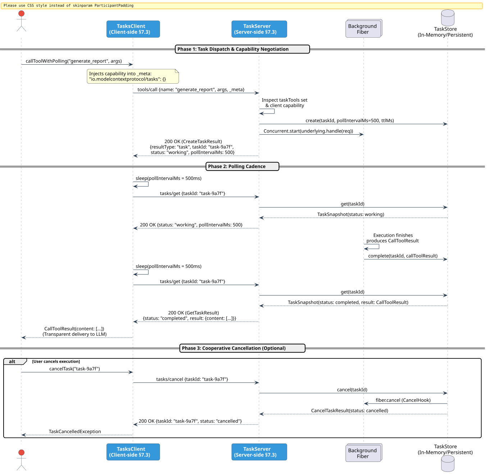

# Tasks Extension & Async Polling (`io.modelcontextprotocol/tasks`)

The **Tasks Extension** (standardized in SEP-2663 and detailed in Section 7.3 of the *MCP Engineering Handbook*) defines an asynchronous execution model for tools that exceed standard request-response timeouts or require prolonged background processing.

In traditional stateless MCP (revision 2026-07-28), tool invocations are synchronous: the client sends `tools/call` and blocks until the server delivers `CallToolResult`. For compute-intensive workloads (e.g., simulations, multi-step LLM batch runs, database exports), this can cause HTTP socket timeouts, buffer exhaustion, or broken connections.

The `iron-mcp-tasks` module provides an end-to-end, reflection-free, cross-compiled (JVM + Scala Native) implementation of the Tasks Extension.

---

## 1. Architectural Lifecycle

The tasks protocol operates on a server-directed asynchronous model:

1. **Capability Declaration**: Clients declare support for the extension by including `"io.modelcontextprotocol/tasks": {}` in `_meta.io.modelcontextprotocol/clientCapabilities.extensions`.
2. **Server-Directed Task Creation**: If the requested tool is marked as asynchronous and the client declared task capability, the server immediately returns a `CreateTaskResult` (`resultType: "task"`) containing a unique `taskId` and a suggested `pollIntervalMs`.
3. **Non-Blocking Polling**: The client polls task status using `tasks/get`. The server answers with a `GetTaskResult` containing current status (`working`, `input_required`, `completed`, `failed`, or `cancelled`).
4. **Inlined Final Result**: When the status reaches `completed`, the snapshot inlines the final `CallToolResult`. There is no separate `tasks/result` endpoint.
5. **Cooperative Cancellation**: Clients can abort unneeded runs via `tasks/cancel`, terminating the background fiber on the server.

### Lifecycle Sequence Diagram



---

## 2. Server Implementation (`TaskServer` & `TaskStore`)

A server designates which tools run asynchronously by wrapping any `ServerHandler[F]` with `TaskServer`.

```scala
import cats.effect.IO
import cats.effect.unsafe.implicits.global
import io.circe.*
import io.circe.syntax.*
import io.github.iltotore.iron.*
import io.github.iltotore.iron.autoRefine
import io.github.iltotore.iron.constraint.all.*
import ironmcp.client.ClientTransport
import ironmcp.protocol.*
import ironmcp.schema.JsonSchemaOf
import ironmcp.server.*
import ironmcp.tasks.*
import ironmcp.tasks.TaskModels.*
import scala.concurrent.duration.*

// Define an input argument schema for a long-running simulation
final case class SimulationArgs(experimentId: String, steps: Int) derives Decoder, JsonSchemaOf

// Define the tool program
val simulationTool = McpTool[SimulationArgs]("run_simulation", "Runs Monte Carlo simulation") { args =>
  IO.sleep(30.millis).as(s"Simulation '${args.experimentId}' finished after ${args.steps} steps.")
}
// simulationTool: McpTool[IO] = McpTool(
//   definition = Tool(
//     name = "run_simulation",
//     inputSchema = ObjectSchema(
//       properties = ListMap(
//         "experimentId" -> JObject(object[type -> "string"]),
//         "steps" -> JObject(object[type -> "integer"])
//       ),
//       required = List("experimentId", "steps"),
//       additional = object[]
//     ),
//     title = None,
//     description = Some("Runs Monte Carlo simulation"),
//     outputSchema = None,
//     annotations = None,
//     icons = None,
//     _meta = None
//   ),
//   invoke = ironmcp.server.McpTool$Builder$$Lambda/0x000000003996ec90@6f3d3f7d,
//   emitting = None
// )

val fastEchoTool = McpTool[SimulationArgs]("quick_ping", "Instant response") { args =>
  IO.pure(s"Pong: ${args.experimentId}")
}
// fastEchoTool: McpTool[IO] = McpTool(
//   definition = Tool(
//     name = "quick_ping",
//     inputSchema = ObjectSchema(
//       properties = ListMap(
//         "experimentId" -> JObject(object[type -> "string"]),
//         "steps" -> JObject(object[type -> "integer"])
//       ),
//       required = List("experimentId", "steps"),
//       additional = object[]
//     ),
//     title = None,
//     description = Some("Instant response"),
//     outputSchema = None,
//     annotations = None,
//     icons = None,
//     _meta = None
//   ),
//   invoke = ironmcp.server.McpTool$Builder$$Lambda/0x000000003996ec90@1bf56a5d,
//   emitting = None
// )
```

### Wrapping the Base Server

The server advertises `io.modelcontextprotocol/tasks` in `server/discover` capabilities and manages background fibers:

```scala
val serverIO: IO[TaskServer[IO]] = for {
  store <- TaskStore.inMemory[IO](defaultPollIntervalMs = 50L)
  baseServer = McpServer[IO](
    info = Implementation(name = "simulation-engine", version = "1.0.0"),
    tools = Some(ToolSet.of(simulationTool, fastEchoTool))
  )
  taskServer = TaskServer[IO](
    underlying = baseServer,
    store = store,
    taskTools = Set("run_simulation"), // only simulation runs as background task
    defaultPollIntervalMs = 50L
  )
} yield taskServer
// serverIO: IO[TaskServer[[A >: Nothing <: Any] =>> IO[A]]] = Map(
//   ioe = Map(
//     ioe = Delay(
//       thunk = cats.effect.IO$$$Lambda/0x00000000399e9b60@3583f9c,
//       event = cats.effect.tracing.TracingEvent$StackTrace
//     ),
//     f = ironmcp.tasks.TaskStore$$$Lambda/0x0000000039a36818@631a5d11,
//     event = cats.effect.tracing.TracingEvent$StackTrace
//   ),
//   f = repl.MdocSession$MdocApp$$Lambda/0x0000000039a3a600@4d1020f6,
//   event = cats.effect.tracing.TracingEvent$StackTrace
// )

val taskServer = serverIO.unsafeRunSync()
// taskServer: TaskServer[[A >: Nothing <: Any] =>> IO[A]] = ironmcp.tasks.TaskServer@2801bfdc
```

---

## 3. Client Implementation (`TasksClient`)

The client side offers two operating modes:
1. **The Transparent Path (`callToolWithPolling`)**: Hides the polling loop behind a single synchronous-looking call. If the server offloads the tool to a task, `TasksClient` polls automatically until completion.
2. **Explicit Task Operations**: Direct control over `callToolAsTask`, `getTask`, `cancelTask`, and `updateTask`.

### The Transparent Path

```scala
val transparentRun: IO[CallToolResult] = for {
  client <- TasksClient[IO](ClientTransport.inProcess[IO](taskServer))
  res <- client.callToolWithPolling(
    "run_simulation",
    JsonObject("experimentId" -> "MC-101".asJson, "steps" -> 50000.asJson),
    defaultPollInterval = 20.millis
  )
} yield res
// transparentRun: IO[CallToolResult] = FlatMap(
//   ioe = FlatMap(
//     ioe = Map(
//       ioe = Delay(
//         thunk = cats.effect.IO$$$Lambda/0x00000000399e9b60@3d71384d,
//         event = cats.effect.tracing.TracingEvent$StackTrace
//       ),
//       f = ironmcp.client.McpClient$$$Lambda/0x0000000039a857a8@7f1754a0,
//       event = cats.effect.tracing.TracingEvent$StackTrace
//     ),
//     f = ironmcp.tasks.TasksClient$$$Lambda/0x0000000039a85de8@4ed47c86,
//     event = cats.effect.tracing.TracingEvent$StackTrace
//   ),
//   f = repl.MdocSession$MdocApp$$Lambda/0x0000000039a88000@28ff23a,
//   event = cats.effect.tracing.TracingEvent$StackTrace
// )

val simulationResult = transparentRun.unsafeRunSync()
// simulationResult: CallToolResult = CallToolResult(
//   content = List(
//     Text(
//       text = "Simulation 'MC-101' finished after 50000 steps.",
//       annotations = None,
//       _meta = None
//     )
//   ),
//   structuredContent = None,
//   isError = Some(false),
//   resultType = Complete,
//   _meta = None
// )
println(simulationResult.content.headOption)
// Some(Text(Simulation 'MC-101' finished after 50000 steps.,None,None))
```

For fast, synchronous tools like `quick_ping`, `callToolWithPolling` returns immediately without polling overhead:

```scala
val fastRun: IO[CallToolResult] = for {
  client <- TasksClient[IO](ClientTransport.inProcess[IO](taskServer))
  res <- client.callToolWithPolling(
    "quick_ping",
    JsonObject("experimentId" -> "ping-test".asJson, "steps" -> 1.asJson)
  )
} yield res
// fastRun: IO[CallToolResult] = FlatMap(
//   ioe = FlatMap(
//     ioe = Map(
//       ioe = Delay(
//         thunk = cats.effect.IO$$$Lambda/0x00000000399e9b60@15348285,
//         event = cats.effect.tracing.TracingEvent$StackTrace
//       ),
//       f = ironmcp.client.McpClient$$$Lambda/0x0000000039a857a8@19cd9c89,
//       event = cats.effect.tracing.TracingEvent$StackTrace
//     ),
//     f = ironmcp.tasks.TasksClient$$$Lambda/0x0000000039a85de8@13fa01f5,
//     event = cats.effect.tracing.TracingEvent$StackTrace
//   ),
//   f = repl.MdocSession$MdocApp$$Lambda/0x0000000039a88e28@7d345f5c,
//   event = cats.effect.tracing.TracingEvent$StackTrace
// )

val fastResult = fastRun.unsafeRunSync()
// fastResult: CallToolResult = CallToolResult(
//   content = List(
//     Text(text = "Pong: ping-test", annotations = None, _meta = None)
//   ),
//   structuredContent = None,
//   isError = Some(false),
//   resultType = Complete,
//   _meta = None
// )
println(fastResult.content.headOption)
// Some(Text(Pong: ping-test,None,None))
```

---

## 4. Explicit Lifecycle & Cooperative Cancellation

When building custom UI or monitoring dashboards, clients can dispatch tasks explicitly and poll or cancel them:

```scala
val cancelRun: IO[(CancelTaskResult, GetTaskResult)] = for {
  client <- TasksClient[IO](ClientTransport.inProcess[IO](taskServer))
  dispatch <- client.callToolAsTask(
    "run_simulation",
    JsonObject("experimentId" -> "long-run".asJson, "steps" -> 999999.asJson)
  )
  created = dispatch match {
    case c: CreateTaskResult => c
    case _                   => sys.error("expected task")
  }
  // Request cooperative cancellation
  cancelRes <- client.cancelTask(created.taskId)
  snap <- client.getTask(created.taskId)
} yield (cancelRes, snap)
// cancelRun: IO[Tuple2[CancelTaskResult, GetTaskResult]] = FlatMap(
//   ioe = FlatMap(
//     ioe = Map(
//       ioe = Delay(
//         thunk = cats.effect.IO$$$Lambda/0x00000000399e9b60@4ca5dad5,
//         event = cats.effect.tracing.TracingEvent$StackTrace
//       ),
//       f = ironmcp.client.McpClient$$$Lambda/0x0000000039a857a8@39f93e1c,
//       event = cats.effect.tracing.TracingEvent$StackTrace
//     ),
//     f = ironmcp.tasks.TasksClient$$$Lambda/0x0000000039a85de8@7acf757f,
//     event = cats.effect.tracing.TracingEvent$StackTrace
//   ),
//   f = repl.MdocSession$MdocApp$$Lambda/0x0000000039a89878@25de0bc5,
//   event = cats.effect.tracing.TracingEvent$StackTrace
// )

val (cancelRes, finalSnapshot) = cancelRun.unsafeRunSync()
// cancelRes: CancelTaskResult = CancelTaskResult(
//   taskId = "task-1a1adfa5151-54f36ea165efb7d7",
//   status = Cancelled
// )
// finalSnapshot: GetTaskResult = GetTaskResult(
//   taskId = "task-1a1adfa5151-54f36ea165efb7d7",
//   status = Cancelled,
//   pollIntervalMs = Some(50L),
//   ttlMs = Some(300000L),
//   createdAt = Some(1793920225L),
//   lastUpdatedAt = Some(1793920225L),
//   result = None,
//   error = None,
//   inputRequest = None
// )
println(s"Cancelled task: ${cancelRes.taskId}, status: ${finalSnapshot.status}")
// Cancelled task: task-1a1adfa5151-54f36ea165efb7d7, status: Cancelled
```

---

## 5. Protocol Wire Messages Reference

### `tools/call` Response (Task Created)
```json
{
  "jsonrpc": "2.0",
  "id": 1,
  "result": {
    "resultType": "task",
    "taskId": "task-18e38d0a",
    "status": "working",
    "pollIntervalMs": 500,
    "ttlMs": 300000
  }
}
```

### `tasks/get` Response (Completed)
```json
{
  "jsonrpc": "2.0",
  "id": 2,
  "result": {
    "taskId": "task-18e38d0a",
    "status": "completed",
    "createdAt": 1730847000,
    "lastUpdatedAt": 1730847002,
    "ttlMs": 300000,
    "result": {
      "content": [
        {
          "type": "text",
          "text": "Simulation finished after 50000 steps."
        }
      ],
      "isError": false
    }
  }
}
```

### `tasks/cancel` Response
```json
{
  "jsonrpc": "2.0",
  "id": 3,
  "result": {
    "taskId": "task-18e38d0a",
    "status": "cancelled"
  }
}
```
